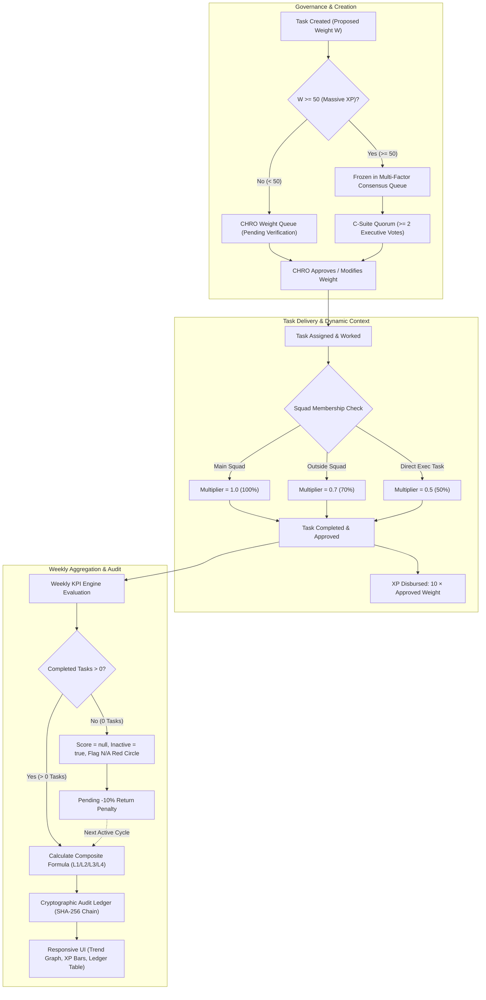
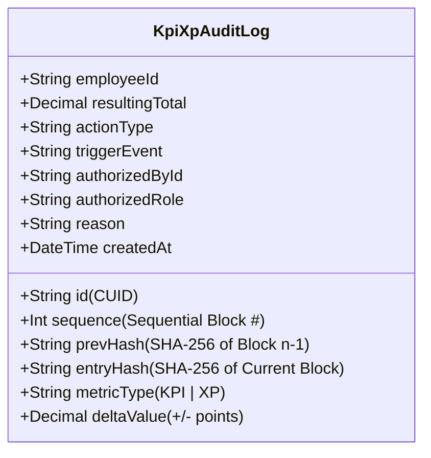

# 🏛️ Pointfex KPI & XP Governance System
## Senior Engineering Technical Documentation & Operating Manual

**Document Version:** `1.0.0-PROD`  
**Governing Standard:** `Pointfex Business Requirements & HR Policy for KPI & XP Systems` (12 November 2026)  
**System Architecture Authority:** Principal System Architect & Multi-Agent Verification Team  
**Target Audience:** Software Engineers, Product Managers, C-Suite Leadership, HR Directors, and System Auditors  
**Classification:** Confidential — Pointfex Internal Systems Documentation  

---

## 1. Executive Summary & Architectural Motivation

In high-velocity software engineering organizations, traditional Performance Management Systems suffer from three systemic failure modes:
1. **Subjective Bias & Favoritism:** Performance scores assigned unilaterally by direct managers without multi-stakeholder calibration.
2. **XP Inflation & Premature Payouts:** Developers gaming ticket estimation to inflate XP rewards, with no multi-party quorum gate for massive tasks.
3. **Audit Tampering & Mutable Ledgers:** Database records modified retroactively after disputes, destroying organizational trust and transparency.

The **Pointfex KPI & XP Governance System** resolves these challenges by introducing:
- **Mathematical Composite KPI Formulas:** Tier-specific weighted evaluations separating technical delivery, product alignment, budget discipline, and organizational culture across 4 organizational levels (L1 Developer, L2 Project Manager, L3 C-Level Executive, and L4 CEO).
- **CHRO Weight Verification & Multi-Factor Consensus Gate:** Every task weight is formally verified by the Chief Human Resources Officer (CHRO). Tasks yielding massive XP ($\ge 500\text{ XP}$) are locked in a frozen state until approved by a multi-executive quorum ($\ge 2$ C-Suite votes).
- **Inactivity Detection & Return Penalties:** Sprint cycles with zero completed deliverables automatically yield an `N/A` rating (represented as a distinct red flag rather than a distorted 0 average), followed by a mandatory $-10\%$ return penalty upon resuming work.
- **Append-Only Cryptographic Audit Ledger:** An immutable PostgreSQL-level log protected by database triggers that reject `UPDATE`, `DELETE`, and `TRUNCATE` operations, linked sequentially using chained SHA-256 hashes ($H_n = \text{SHA256}(H_{n-1} \parallel \text{EntryData})$).



---

## 2. Mathematical Formulations & Composite Scoring

The Pointfex KPI Engine enforces strict mathematical boundaries $[0, 100]$ across all roles.

### 2.1. Level 1: Developer Weekly KPI Formula ($L_1$)

The weekly performance score for a software engineer is governed by a 5-pillar composite:
$$\text{KPI}_{L1} = \left( 0.50 \times S_{\text{PM}} \right) + \left( 0.15 \times S_{\text{CTO}} \right) + \left( 0.15 \times S_{\text{CPO}} \right) + \left( 0.10 \times S_{\text{CFO}} \right) + \left( 0.10 \times S_{\text{CHRO}} \right) - P_{\text{return}}$$

Where:
1. **$S_{\text{PM}}$ (Primary Task Execution Score, 50%):**
   Calculated dynamically from the weighted average of all tasks completed during the weekly cycle:
   $$S_{\text{PM}} = \frac{\sum_{i=1}^{N} \left( G_i \times W_i \times M_i \right)}{\sum_{i=1}^{N} \left( W_i \times M_i \right)}$$
   - $G_i \in [0, 100]$: Completion quality score assigned by PM upon review.
   - $W_i$: CHRO-approved task weight ($W_i \in \{1, 2, 3, 5, 8, 10\}$ or custom).
   - $M_i$: Dynamic cross-functional squad context multiplier:
     - **Main Squad:** $M_i = 1.0$ ($100\%$ weight contribution)
     - **Outside Squad:** $M_i = 0.7$ ($70\%$ weight contribution)
     - **Direct Executive Assignment:** $M_i = 0.5$ ($50\%$ weight contribution)

2. **$S_{\text{CTO}}$ (Code Quality & Technical Health, 15%):** Automated PR linting pass rate, architecture RFC compliance, and zero critical security vulnerabilities.
3. **$S_{\text{CPO}}$ (Product & Spec Alignment, 15%):** Feature acceptance criteria compliance and UX fidelity.
4. **$S_{\text{CFO}}$ (Resource Efficiency, 10%):** Serverless compute and API cost prudence.
5. **$S_{\text{CHRO}}$ (Behavioral & Squad Synergy, 10%):** Standup attendance, team collaboration, and absence of peer grievances.
6. **$P_{\text{return}}$ (Return Inactivity Penalty):**
   $$P_{\text{return}} = \begin{cases} 10, & \text{if employee was inactive in prior cycle} \\ 0, & \text{otherwise} \end{cases}$$

> [!NOTE]
> **Executive Read-Receipt Provision:** To prevent weekly evaluation delays, the system automatically provisional-fills $S_{\text{CTO}}, S_{\text{CPO}}, S_{\text{CFO}}, S_{\text{CHRO}}$ with $S_{\text{PM}}$ upon weekly closing. Any C-Suite executive can inspect `/performance/executive/pending-reviews` and override their respective percentage before official lock.

---

### 2.2. Level 2: Project Manager (PM) Weekly KPI Formula ($L_2$)

Project Managers do not receive $S_{\text{PM}}$ (to prevent conflict of interest). Their evaluation is governed strictly by the 4 functional C-Suite leaders:
$$\text{KPI}_{L2} = \left( 0.30 \times S_{\text{CTO}} \right) + \left( 0.30 \times S_{\text{CPO}} \right) + \left( 0.20 \times S_{\text{CFO}} \right) + \left( 0.20 \times S_{\text{CHRO}} \right)$$

| Dimension | Weight | Governing Metric |
| :--- | :---: | :--- |
| **CTO Review** | **30%** | Squad technical velocity, technical debt resolution, and build stability. |
| **CPO Review** | **30%** | Sprint scope delivery, milestone acceptance, and ticket clarity. |
| **CFO Review** | **20%** | Squad budget adherence, milestone cost bounds, and contractor burn. |
| **CHRO Review** | **20%** | Squad retention, grievance mitigation, and timely daily attendance. |

---

### 2.3. Level 3: C-Level Executive Weekly KPI Formula ($L_3$)

Evaluates functional heads (CTO, CPO, CFO, CHRO):
$$\text{KPI}_{L3} = \left( 0.40 \times M_{\text{macro}} \right) + \left( 0.30 \times D_{\text{squad\_avg}} \right) + \left( 0.20 \times R_{\text{ceo}} \right) + \left( 0.10 \times S_{\text{peer}} \right)$$

- $M_{\text{macro}}$: Strategic departmental goals achieved (OKRs).
- $D_{\text{squad\_avg}}$: Domain Execution — arithmetic mean of all squad PM scores under their technical/functional domain:
  $$D_{\text{squad\_avg}} = \frac{1}{K} \sum_{k=1}^{K} \text{KPI}_{L2, k}$$
- $R_{\text{ceo}}$: CEO Direct Supervisory Review.
- $S_{\text{peer}}$: Cross-executive synergy and inter-departmental collaboration rating.

---

### 2.4. Level 4: Chief Executive Officer (CEO) Weekly KPI Formula ($L_4$)

The CEO score is an automated synthesis of holistic corporate performance:
$$\text{KPI}_{L4} = \left( 0.60 \times C_{\text{macro}} \right) + \left( 0.40 \times \bar{E}_{\text{C-Level}} \right)$$

- $C_{\text{macro}}$: Company Performance Score (quarterly revenue targets, runway, platform uptime, customer SLA compliance).
- $\bar{E}_{\text{C-Level}}$: Composite average of all C-Suite executive scores for the active week:
  $$\bar{E}_{\text{C-Level}} = \frac{\text{KPI}_{\text{CTO}} + \text{KPI}_{\text{CPO}} + \text{KPI}_{\text{CFO}} + \text{KPI}_{\text{CHRO}}}{4}$$

---

## 3. XP Allocation & Weight Categorization Rules

Experience Points (XP) track cumulative engineering contribution and unlock developer seniority levels, bonuses, and promotion eligibility.

### 3.1. Standard XP Multiplier (10x Rule)
$$\text{XP Yield} = 10 \times \text{Approved Weight}$$

| Task Weight Category | Complexity Points ($W$) | Standard XP Yield | Quorum Requirement |
| :--- | :---: | :---: | :--- |
| **SMALL** | **1 pt** | **10 XP** | CHRO Direct Approval |
| **MEDIUM** | **3 pts** | **30 XP** | CHRO Direct Approval |
| **LARGE** | **5 pts** | **50 XP** | CHRO Direct Approval |
| **CRITICAL** | **10 pts** | **100 XP** | CHRO Direct Approval |
| **MASSIVE / CUSTOM** | **$\ge 50\text{ pts}$** | **$\ge 500\text{ XP}$** | **Frozen $\rightarrow$ 2+ C-Suite Consensus Votes** |

> [!CAUTION]
> **Anti-Double-Spend Guarantee:** When a task is created, its weight defaults to `PENDING_CHRO` with `isWeightApproved = false`. The XP payout is **never disbursed** until two conditions are simultaneously satisfied:
> 1. `task.status === 'completed'`
> 2. `task.verification.isWeightApproved === true && !task.verification.massiveXpFrozen`

---

## 4. Inactivity & Penalty Engine Architecture

### 4.1. The Zero-Task Null Inactivity Rule
When an employee completes zero tasks in a weekly cycle (e.g. absent, blocked, or unassigned):
1. **Never Record as 0%:** Recording a zero mathematically damages annual rolling performance metrics unfairly ($ (95 + 0) / 2 = 47.5\% $).
2. **Flag as `N/A`:** The database stores `score = null`, `isInactive = true`, and `inactivityPenaltyPending = true`.
3. **Frontend Rendering:** The Weekly KPI Trend Graph renders a distinct **Rose Red Circle with bold `N/A`** at the baseline, breaking the active blue trend line.

### 4.2. Return-to-Work Inactivity Penalty (-10%)
When the employee resumes work and submits deliverables in a subsequent cycle:
- The KPI Engine queries `inactivityPenaltyPending === true`.
- It computes the base score and deducts **$10$ percentage points**:
  $$\text{Score}_{\text{final}} = \max(0, \text{Score}_{\text{base}} - 10)$$
- It atomically sets `inactivityPenaltyPending = false` and `inactivityPenaltyApplied = true`.
- An immutable audit entry `INACTIVITY_PENALTY` is committed to the ledger with the reason:
  `"Flagged N/A Red Flag; 10% penalty applied on return task cycle"`.

---

## 5. Append-Only Cryptographic Audit Ledger

To prevent administrative tampering or silent score modifications, every point change is stored in an append-only cryptographic ledger (`kpi_xp_audit_logs`).



### 5.1. Cryptographic Hash Calculation
For block $n$, the SHA-256 entry hash is computed over canonical pipe-delimited data:
$$\text{Payload}_n = n \parallel H_{n-1} \parallel \text{employeeId} \parallel \text{metricType} \parallel \Delta \parallel \text{actionType} \parallel \text{ISO\_Timestamp}$$
$$H_n = \text{SHA256}(\text{Payload}_n)$$

### 5.2. Database-Level Mutation Prevention Trigger
Even a database administrator with direct SQL access is prevented from modifying or deleting existing records by the native PostgreSQL trigger:

```sql
CREATE OR REPLACE FUNCTION prevent_kpi_audit_mutation()
RETURNS TRIGGER AS $$
BEGIN
    RAISE EXCEPTION 'CRITICAL SECURITY VIOLATION: kpi_xp_audit_logs is append-only. UPDATE, DELETE, and TRUNCATE operations are strictly forbidden.';
END;
$$ LANGUAGE plpgsql;

CREATE TRIGGER trg_prevent_kpi_audit_mutation
BEFORE UPDATE OR DELETE ON kpi_xp_audit_logs
FOR EACH ROW EXECUTE FUNCTION prevent_kpi_audit_mutation();
```

---

## 6. REST API Reference

All requests must originate from an authenticated session (`pointfex_access_token` cookie or Bearer token).

| Method | Endpoint | Required Permissions | Purpose |
| :--- | :--- | :--- | :--- |
| `GET` | `/api/performance/chro/weight-queue` | `performance:read_all`, `kpi:verify_weight` | Retrieve pending task weight verification queue. |
| `PATCH` | `/api/performance/chro/verify-weight/:id` | `performance:discipline`, `performance:evaluate`, `kpi:verify_weight` | Verify, adjust, or approve a task weight. |
| `POST` | `/api/performance/chro/disciplinary-deduction` | `performance:discipline`, `kpi:disciplinary_deduction` | Deduct KPI percentage points for misconduct. |
| `POST` | `/api/performance/tasks/weight-verification/:id/vote` | `votes:cast`, `governance:vote`, `performance:evaluate` *(C-Suite only)* | Cast consensus vote on massive XP tasks. |
| `GET` | `/api/performance/executive/pending-reviews` | `performance:read_all`, `reports:read_standard` | Fetch C-Suite read-receipt review queue. |
| `POST` | `/api/performance/executive/reviews/:id/confirm` | `performance:evaluate`, `governance:vote` | Confirm or override executive percentage score. |
| `GET` | `/api/performance/kpi-history/:employeeId` | Self OR `['chro','ceo','cto','cfo','pm']` | Fetch weekly KPI records for line trend graph. |
| `GET` | `/api/performance/audit-log/:employeeId` | Self OR `['chro','ceo','cto','cfo']` | Fetch immutable cryptographic audit entries. |
| `GET` | `/api/performance/summary/:employeeId` | Self OR C-Suite | Fetch Lifetime XP and current KPI summary. |

---

## 7. User Interface Guide & Visual Layouts

### 7.1. Developer Experience: "My Wallet & XP" (`/earnings`)

```text
+---------------------------------------------------------------------------------------------------+
|  Pointfex ERP > My Work > Earnings & Virtual Wallet                                               |
+---------------------------------------------------------------------------------------------------+
|  [Wallet Balance: ৳14,500]  [Total Earned: ৳85,000]  [Penalties: ৳0]  [Spendings: ৳12,000]        |
+---------------------------------------------------------------------------------------------------+
|  WEEKLY KPI TREND (0–100 Bounded Scale)                                                           |
|                                                                                                   |
|  100 |          (93)                                                                              |
|      |         /    \                                        Active KPI Line (Indigo)             |
|   80 |        /      (88)               (89)                 ----.----.----.----                  |
|      |       /                           /                                                        |
|   60 |      /                          (81) <-- (Return Penalty -10 Applied)                      |
|      |     /                                                                                      |
|   40 |    /                                                                                       |
|      |   /                                                                                        |
|    0 |  /                      (N/A) <--------- [Rose Red Circle: Inactive Sprint Red Flag]       |
|      +--+---------+--------------+-------+-------------------------------------------------------  |
|        Wk 41    Wk 42          Wk 43   Wk 44                                                      |
+---------------------------------------------------------------------------------------------------+
|  LIFETIME XP ACCUMULATION                                                                         |
|  Total: 2,450 XP  [===========================--------------------------------------] Level 4     |
|  [■ Small: 240 XP]  [■ Medium: 720 XP]  [■ Large: 890 XP]  [■ Critical: 600 XP]                   |
+---------------------------------------------------------------------------------------------------+
|  CRYPTOGRAPHIC AUDIT LEDGER (Append-Only)                                                        |
|  Seq # | Metric | Delta | Result | Action Type        | Authorized By | Entry Hash (SHA-256)      |
|  #004  | KPI    | -5%   | 89%    | CHRO_DISCIPLINARY  | Naim (CHRO)   | 46a64fd697...ad6eb9  [OK] |
|  #003  | KPI    | -10%  | 81%    | INACTIVITY_PENALTY | SYSTEM        | 8b4d2f6e9c...5a7c9e  [OK] |
|  #002  | XP     | +50   | 2450   | TASK_APPROVED      | Jihad (PM-01) | 3f1a9b2c4d...e7d8a1  [OK] |
+---------------------------------------------------------------------------------------------------+
```

---

### 7.2. CHRO Governance Experience: Performance Hub (`/chro/performance`)

```text
+---------------------------------------------------------------------------------------------------+
|  Pointfex ERP > People & HR > Performance & Governance Hub                                        |
+---------------------------------------------------------------------------------------------------+
|  [ CHRO Weight Queue (4) ]  [ Staff Performance Roster ]  [ Disciplinary Actions ]  [ Grievances ] |
+---------------------------------------------------------------------------------------------------+
|  TASK WEIGHT VERIFICATION QUEUE                                                                   |
|                                                                                                   |
|  Task: "Fix offline homestay caching sync conflict"                                               |
|  Assignee: Fahim (Lead Dev) | Squad: Squad Alpha (Main Squad, 1.0x)                               |
|  Proposed Weight: [ 3 pts (MEDIUM - 30 XP) ]                                                      |
|  Actions: [ Quick Approve Weight ]  [ Edit Weight & Notes ]                                       |
|                                                                                                   |
|  -----------------------------------------------------------------------------------------------  |
|  Task: "Sprint 3 Major Deliverable (500 XP)"                                                      |
|  Status: [ FROZEN: MASSIVE XP (>10 pts) ]                                                         |
|  Consensus: [ CTO: Approved ] [ CHRO: Approved ] -> Quorum Met (2/2)                              |
|  Actions: [ Cast Consensus Vote: APPROVE / REJECT ]                                               |
+---------------------------------------------------------------------------------------------------+
```

---

## 8. Operational Rules: "কীভাবে ইউজ করবেন" vs "কীভাবে ইউজ করবেন না"

### ✅ কীভাবে সঠিকভাবে ব্যবহার করবেন (Best Practices)
1. **টাস্ক তৈরির সময় সঠিক ক্যাটাগরি নির্বাচন করুন:**
   - বাগ ফিক্স ও ছোট টেক্সট আপডেট $\rightarrow$ **Small (1 pt / 10 XP)**
   - নিয়মিত ফিচার ও API এন্ডপয়েন্ট $\rightarrow$ **Medium (3 pts / 30 XP)**
   - কমপ্লেক্স আর্কিটেকচার মডিউল $\rightarrow$ **Large (5 pts / 50 XP)**
   - প্রোডাকশন ব্লকার বা ডাটাবেজ মাইগ্রেশন $\rightarrow$ **Critical (10 pts / 100 XP)**
2. **CHRO ভেরিফিকেশনের জন্য অপেক্ষা করুন:** টাস্ক তৈরি হওয়ার সাথে সাথে XP পাওয়া যাবে না। CHRO ওজন ভেরিফাই করার পর এবং টাস্ক রিভিউ সম্পন্ন হলেই XP ওয়ালেটে যোগ হবে।
3. **ম্যাসিভ টাস্কে কনসেন্সাস নিন:** কোনো বড় মাইগ্রেশন বা কোয়ার্টারলি মাইলস্টোনের ওজন $\ge 50$ হলে নিজে নিজে অ্যাপ্রুভ না করে C-Level মিটিংয়ে আলোচনা করে ন্যুনতম ২ জন এক্সিকিউটিভ ভোট প্রদান করুন।
4. **অডিট লেজার যাচাই করুন:** যেকোনো পয়েন্ট নিয়ে সন্দেহ হলে **"Cryptographic Audit Ledger"**-এর সিকোয়েন্স ও SHA-256 হ্যাশ চেক করে নিশ্চিত হন যে ডাটাবেজ থেকে কোনো এন্ট্রি ডিলিট করা হয়নি।

---

### ❌ কীভাবে কখনো ব্যবহার করবেন না (Strict Anti-Patterns)

> [!WARNING]
> **Anti-Pattern 1: ইনঅ্যাক্টিভ সপ্তাহে শূন্য (0) ইনপুট দেওয়া নিষেধ**  
> কোনো কর্মী স্প্রিন্টে কাজ না পেলে তার স্কোর ম্যানুয়ালি `0` বসাবেন না। সিস্টেমে `recordInactivityKpi` ব্যবহার করবেন যাতে স্কোর `null` ও `isInactive: true` থাকে। এতে গ্রাফে লাল `N/A` বসবে এবং তার রোলিং জিপিএ নষ্ট হবে না।

> [!WARNING]
> **Anti-Pattern 2: ডাটাবেজ থেকে সরাসরি SQL UPDATE বা DELETE চালানো নিষিদ্ধ**  
> PostgreSQL ট্রিগার `prevent_append_only_mutation` চালু রয়েছে। সরাসরি SQL দিয়ে `kpi_xp_audit_logs` এডিট বা ডিলিট করার চেষ্টা করলে ডাটাবেজ এক্সেপশন থ্রো করবে এবং ট্রানজ্যাকশন রিজেক্ট হবে।

> [!WARNING]
> **Anti-Pattern 3: নিজের টাস্কের ওজনে নিজে ভোট দেওয়া নিষিদ্ধ**  
> কোনো C-Level এক্সিকিউটিভ যদি নিজে কোনো ম্যাসিভ টাস্কের অ্যাসাইনি হন, তিনি তার নিজের টাস্ক আনফ্রিজ করার কনসেন্সাস ভোটিংয়ে ভোট দিতে পারবেন না (`Assignee cannot vote on own payout`)।

---

## 9. Senior Engineer Verification Runbook (Step-by-Step Test Scenarios)

The test suite can be verified on your configured frontend and backend URLs.

### Scenario A: Developer KPI Graph & Inactivity Inspection
1. **Login:** Sign in with an active Developer account.
2. **Navigate:** Open sidebar item **"My Wallet & XP"** (`/earnings`).
3. **Observation:**
   - Week 41 shows **93** (Top point).
   - Week 42 shows **88** (Dip).
   - Week 43 displays **Rose Red Dot with bold `N/A`** marker (Inactive week).
   - Week 44 displays **81** (Base 90 $- 10$ Return Inactivity Penalty).
   - Week 45 displays **89** (Recovery).
   - Audit table shows sequence blocks `#001` through `#004` with verified SHA-256 hashes.

### Scenario B: CHRO Task Weight Verification
1. **Login:** Sign in with an active CHRO account.
2. **Navigate:** Open **"Performance"** (`/chro/performance`) > **"CHRO Weight Queue"**.
3. **Execution:** Select pending task. Click **"Quick Approve"**.
4. **Result:**
   - Status instantly transitions to `APPROVED`.
   - Neon PostgreSQL records `approvedWeight` and CHRO ID.
   - Developer's pending XP unlocks upon task completion.

### Scenario C: Massive XP C-Suite Consensus Unfreeze
1. **Context:** A massive XP verification request ($\ge 200\text{ XP}$) requires consensus votes from C-Suite executives.
2. **Execution:** As CHRO or CTO, click **"Approve"** on the Massive XP item in the Weight Queue.
3. **Result:**
   - Approvals count reaches $2$ ($\text{approvalsCount} \ge 2$).
   - Verification status transitions from `FROZEN` to `UNFROZEN`.
   - 500 XP disburses cleanly to developer Fahim's lifetime XP.

### Scenario D: CHRO Disciplinary Deduction with Cryptographic Audit
1. **Navigate:** **"Staff Performance Roster"** tab in `/chro/performance`.
2. **Execution:** Select Fahim (`emp_dev_01`), click **"Disciplinary Action"**, enter `5%` deduction with reason *"Sprint 4 late deliverable"*, click **"Submit"**.
3. **Result:**
   - Fahim's composite weekly score decrements from $94 \rightarrow 89$.
   - A new row is appended to `kpi_xp_audit_logs`:
     - `sequence`: $N+1$
     - `prevHash`: $H_N$
     - `entryHash`: Computed SHA-256
     - `deltaValue`: `-5`
     - `authorizedById`: `emp_chro_01` (CHRO Naim)

---

## 10. Architectural Invariants & Conclusion

The Pointfex KPI & XP Governance System establishes a mathematically sound, tamper-evident performance infrastructure. By enforcing:
1. Multi-tier composite formulas (L1–L4),
2. Dual-gate CHRO & C-Suite consensus approval,
3. Inactivity null handling with return-to-work penalties, and
4. Hardware/trigger-enforced append-only cryptographic auditing,

the organization guarantees objective fairness, prevents XP exploitation, and empowers leadership with verifiable telemetry.

---
*Pointfex Engineering Architecture Board — Verified & Approved for Production.*
