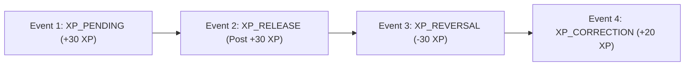
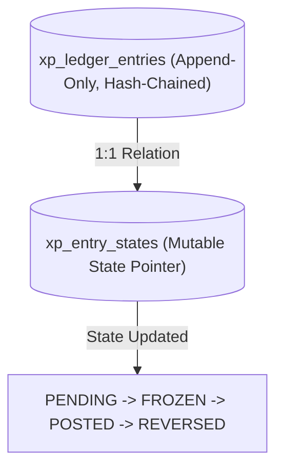

# ADR-001: Append-Only XP Ledger State Lifecycle Architecture

**Status:** Proposed (Awaiting CEO / Architect Approval for Phase 3 Implementation)  
**Date:** 17 November 2026  
**Context:** Pointfex ERP v3.14.0+ KPI & XP Governance Suite  
**Author:** Senior Full-Stack Engineering Agent  

---

## 1. Context & Problem Statement

The Pointfex governance model strictly mandates that all financial, KPI, and XP ledgers are **strictly append-only**:
- Database triggers reject `UPDATE`, `DELETE`, and `TRUNCATE` operations on ledger tables.
- Every entry is sequentially linked via a cryptographic SHA-256 hash chain:
  $$H_n = \text{SHA256}(n \parallel H_{n-1} \parallel \text{employeeId} \parallel \text{metricType} \parallel \Delta \parallel \text{timestamp})$$

However, an XP award associated with a task passes through lifecycle state transitions:
1. When a task completes before weight is verified: status is `PENDING`.
2. When weight is verified and yield $\ge 200\text{ XP}$ (or weight $\ge 20$): status is `FROZEN`.
3. When C-level consensus quorum or CEO override approves release: status becomes `POSTED` (active in balance).
4. If CHRO revises weight after release: previous yield must transition to `REVERSED` and a corrected entry posted.

Because database triggers strictly prohibit `UPDATE` on `xp_ledger_entries`, the system must adopt a definitive architectural pattern to model these status transitions over time.

---

## 2. Options Considered

### Option A: Event-Sourced Lifecycle (Pure Append-Only Event Stream)

In this approach, the ledger represents an immutable log of state events. Status changes are represented by appending new state transition events rather than updating an existing row.

#### Mechanism:
- Initial entry is inserted as `XP_PENDING` (or `XP_FROZEN`). It carries $\Delta = 0$ toward active lifetime XP, or carries `delta = 30` with flag `state = PENDING`.
- Upon verification/release, an `XP_RELEASE` (or `XP_AWARD_POSTED`) event is appended, referencing `sourceEntryId`, applying the positive $\Delta$.
- Reversals append an `XP_REVERSAL` event with negative delta ($-\Delta$).
- **Balance Computation:** The active career XP is the sum of posted deltas:
  $$\text{Lifetime XP} = \sum_{e \in \text{POSTED Events}} \Delta_e$$
  To prevent recalculation on every leaderboard query, the running total is stored in `employees.lifetimeXp` and incremented/decremented atomically in the same database transaction.

---

### Option B: Dual-Table Architecture (Immutable Ledger + Mutable State Table `xp_entry_state`)

In this approach, the ledger table `xp_ledger_entries` remains strictly append-only and cryptographically chained, while a companion table `xp_entry_states` stores the mutable pointer.

#### Mechanism:
- When a task is completed, an immutable row is appended to `xp_ledger_entries`.
- A companion row is inserted into `xp_entry_states` with `status = 'PENDING'`.
- When CHRO verifies weight or quorum votes release, `xp_entry_states.status` is updated to `'POSTED'`.
- Triggers on `xp_entry_states` allow `UPDATE status`, but `xp_ledger_entries` remains immutable.

---

## 3. Detailed Architectural Comparison

| Evaluation Dimension | Option A: Pure Event-Sourced Stream | Option B: Mutable Companion Table (`xp_entry_state`) |
| :--- | :--- | :--- |
| **Hash-Chain Cryptographic Integrity** | **Superior.** Every lifecycle state change is cryptographically hashed into the ledger chain. Zero unhashed state transitions. | **Compromised.** State transitions occur outside the SHA-256 chain. An attacker or rogue DBA could alter `status` without breaking the ledger hash. |
| **Audit Evidence & Forensic Replay** | **Complete.** Full timeline of who froze, who released, and when each transition occurred is natively preserved in ledger sequence. | **Partial.** Requires a secondary history log on `xp_entry_states` to know when it changed from `FROZEN` to `POSTED`. |
| **Race Conditions & Concurrency** | **Low risk.** Inserts are commutative; PostgreSQL append operations do not encounter row-level lock contention on state updates. | **High risk.** Requires `SELECT ... FOR UPDATE` locks on `xp_entry_states` rows during concurrent voting or CEO overrides. |
| **Leaderboard Query Performance** | **Optimal.** Maintained via indexed `employees.lifetimeXp` counter; zero joins required for leaderboard rendering. | **Moderate.** Requires join between `employees` and `xp_entry_states` or querying secondary summary views. |
| **CHRO Weight Reversal Semantics** | **Native double-entry.** Reversal posts compensatory negative delta row ($-\Delta$) followed by correct yield ($+\Delta_{\text{new}}$). | **Complex.** Must handle both state flag reversal and balance adjustment across two decoupled tables. |
| **Database Trigger Compatibility** | **100% compliant.** Works out of the box with `trg_xp_ledger_entries_immutable` and zero trigger bypasses. | **Requires exception.** Requires maintaining different trigger policies across ledger vs state tables. |

---

## 4. Recommendation: Option A (Event-Sourced Append-Only Ledger)

We strongly recommend **Option A (Pure Event-Sourced Stream)** for the following decisive reasons:

1. **Constitutional Alignment with Pointfex Governance:** The core tenet of the Pointfex ERP governance suite is that **every state alteration is an explicit, hash-chained transaction**. Option B re-introduces mutable row state, eroding the zero-trust audit promise.
2. **Double-Entry Financial Accounting Standard:** In standard double-entry bookkeeping, an invoice or transaction state is never modified in-place; adjustments, voids, and holds are ledger entries.
3. **Zero Mutation Friction:** With Option A, the existing trigger `trg_xp_ledger_entries_immutable` remains strictly intact and enforced at the engine level without exceptions or security loopholes.
4. **Performance via Synchronous Materialized Balance:** By updating `Employee.lifetimeXp` in the same database transaction as the append-only event insertion, Leaderboard queries read directly from `employees.lifetimeXp` with zero latency overhead.

---

## 5. Decision Checkpoint

- **Engine Readiness:** The pure calculation engine implemented in Phase 2 is **strictly agnostic** to this choice: it evaluates input deltas and status flags purely from typed domain arguments.
- **Action Required:** Awaiting review and approval from user before implementing the Phase 3 persistence layer.

