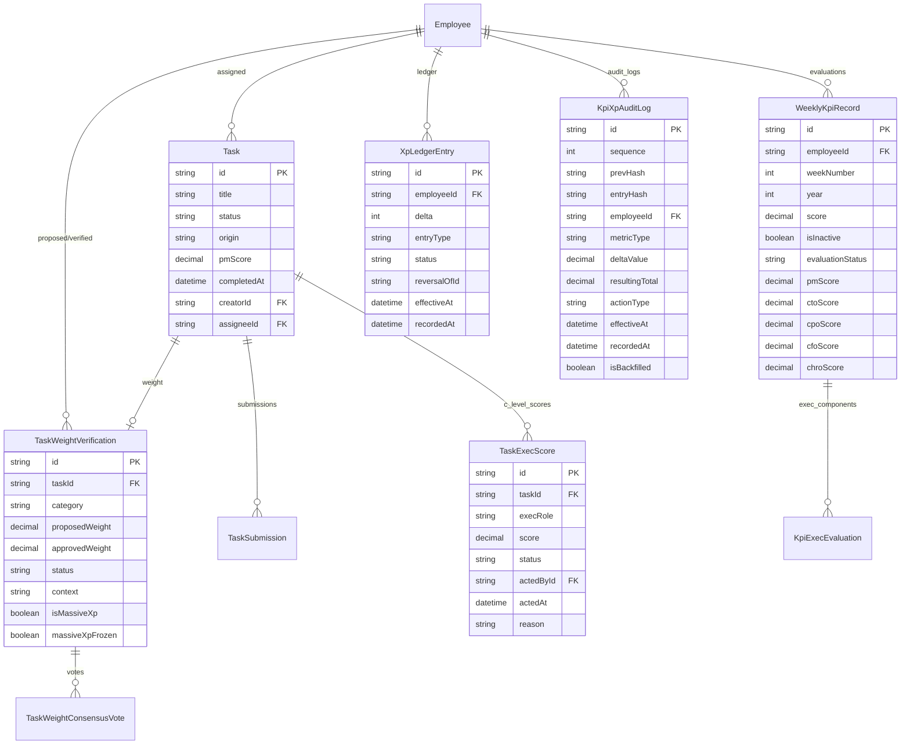

# Pointfex KPI & XP System — System Architecture

**Classification:** Enterprise System Architecture Specification  
**Platform:** NestJS (Backend), React 19 + Vite (Frontend), PostgreSQL / Neon DB, Prisma ORM  
**Governing Standard:** CHRO Memorandum (12 Nov 2026)  

---

## 1. High-Level Architecture

The Pointfex Performance Module is built around four core layers:
1. **Core Domain Services & Mathematical Engine:** Pure, deterministic functions executing hierarchical multi-tiered KPI formulas and XP derivations without side-effects.
2. **Cryptographic Append-Only Ledger:** Tamper-evident ledger linking every balance change using SHA-256 hash chaining, with database-level protection against `UPDATE` and `DELETE`.
3. **Multi-Party Governance & Policy Gates:** CHRO weight gate, C-Level read-receipt workflows, massive XP quorum voting ($\ge 200\text{ XP}$), and SOD policy guards.
4. **Dynamic Frontend Interface:** Responsive React 19 views with SVG trend charts, stacked XP bar progressions, real-time leaderboard, and dedicated role consoles (PM, CHRO, C-Level).

```mermaid
flowchart TD
    subgraph Client["Frontend Client (React 19 + Tailwind)"]
        UI_Dash["Dashboard Hero (Trend & XP Stacked)"]
        UI_Leaderboard["Company Leaderboard (KPI & XP)"]
        UI_PM["PM Workspace (Task Weight & Review)"]
        UI_CHRO["CHRO Console (Weight Queue & Discipline)"]
        UI_Exec["C-Level Inbox (UNREAD Read-Receipts)"]
    end

    subgraph Gateway["NestJS Controllers & Security Guards"]
        Guard_Auth["JwtAuthGuard + PermissionsGuard"]
        Guard_MFA["RequiresFreshMfa (TOTP)"]
        Guard_SOD["SodValidator (SOD-TASK & Maker-Checker)"]
    end

    subgraph Services["Application Services"]
        TaskSvc["TasksService (State Machine)"]
        KpiEngine["KpiEngineService (Pure Formulas)"]
        LedgerSvc["LedgerService (Cryptographic Chaining)"]
        BackfillSvc["BackfillService (Dhaka Time Window)"]
        ExecScoreSvc["ExecutiveScoringService (Read-Receipt)"]
        CronSvc["CronSweepService (Weekly Sweeps & Audit)"]
    end

    subgraph Storage["PostgreSQL / Neon Database (Prisma)"]
        DB_Tasks[("tasks + task_weight_verifications")]
        DB_ExecScores[("task_exec_scores")]
        DB_WeeklyKpi[("weekly_kpi_records")]
        DB_Ledgers[("xp_ledger_entries + kpi_xp_audit_logs")]
        DB_Config[("task_weight_configs + kpi_configs")]
        DB_Backfill[("backfill_windows")]
    end

    Client --> Gateway
    Gateway --> Services
    Services --> Storage
```

---

## 2. Component & Service Decomposition

### 2.1 `KpiEngineService`
- Pure, side-effect-free calculation engine.
- Functions:
  - `computeTaskKpiScore(pmScore, cto, cpo, cfo, chro, hasInactivityPenalty)`
  - `computeWeeklyDeveloperKpi(tasks: { score, weight, multiplier }[])`
  - `computeWeeklyPmKpi(cto, cpo, cfo, chro)`
  - `computeWeeklyCLevelKpi(companyGoal, domainExecution, ceoReview, peerSynergy)`
  - `computeWeeklyCeoKpi(companyPerformance, cLevelAggregate)`
  - `calculateXpYield(verifiedWeightPoints)`
- Guarantees strict $[0, 100]$ bounds and 2-decimal rounding.

### 2.2 `TaskLifecycleService` & `TasksService`
- Orchestrates task status transitions:
  `DRAFT -> ASSIGNED -> IN_PROGRESS -> IN_REVIEW -> COMPLETED` (or `RETURNED` / `CANCELLED`).
- Enforces:
  - Weight proposal upon assignment (`PENDING_CHRO_VERIFICATION`).
  - Work submission (`tasks:submit_work`).
  - PM Review with satisfaction score ($0 \le S \le 100$).
  - Generation of provisional C-Level read-receipt records (`TaskExecScore`).
  - Segregation of Duties: PM cannot approve self-assigned tasks.

### 2.3 `LedgerService` & Cryptographic Chaining
- Writes to `xp_ledger_entries` and `kpi_xp_audit_logs`.
- SHA-256 sequential hashing:
  $$H_n = \text{SHA256}(n \parallel H_{n-1} \parallel \text{userId} \parallel \text{type} \parallel \Delta \parallel \text{timestamp})$$
- Enforces append-only rules: no modification or deletion. Corrections are strictly paired adjustment entries (`XP_REVERSAL` or `KPI_ADJUSTMENT`).

### 2.4 `BackfillService` (Dhaka Timezone Engine)
- Timezone: `Asia/Dhaka` (UTC+6).
- Validates active `BackfillWindow` record ($T_{\text{now}} \le T_{\text{cutoff}}$).
- Backfill cutoff: **2026-11-19 23:59:59 (Asia/Dhaka)**.
- Enforces squad-only scope for PMs; routes post-window or cross-squad requests to CHRO/CEO with mandatory MFA.
- Automatically triggers deterministic weekly KPI recalculations for historical weeks affected by backfilled deliverables.

---

## 3. Database Schema Architecture

---

## 4. Security & Governance Invariants

1. **Tier Ceiling & Maker-Checker:**
   - Developers cannot verify task weights, self-review, or adjust scores.
   - PMs propose weights and review developer deliverables within their assigned squads. PMs cannot verify their own proposed weights.
   - CHRO holds primary weight verification authority; self-proposed weights route to CEO.
   - C-Level executives evaluate their respective domain components.
   - CEO holds ultimate override authority protected strictly by fresh 6-digit TOTP MFA.

2. **Immutable Ledgers:**
   - Ledger tables (`kpi_xp_audit_logs`, `xp_ledger_entries`) allow `INSERT` and `SELECT` only.
   - Database triggers intercept and raise exceptions on any `UPDATE`, `DELETE`, or `TRUNCATE` operations.
   - SHA-256 chain verified periodically via cron sweep.

3. **Dhaka Calendar Week Calculation:**
   - Week boundaries:
     $$\text{Start} = \text{Monday 00:00:00.000 (UTC+6)}$$
     $$\text{End} = \text{Sunday 23:59:59.999 (UTC+6)}$$
   - Computed deterministically and converted to UTC timestamps for PostgreSQL storage.

---
**Architecture Approved.** Ready for Phase 1 (Schema & Migrations).

